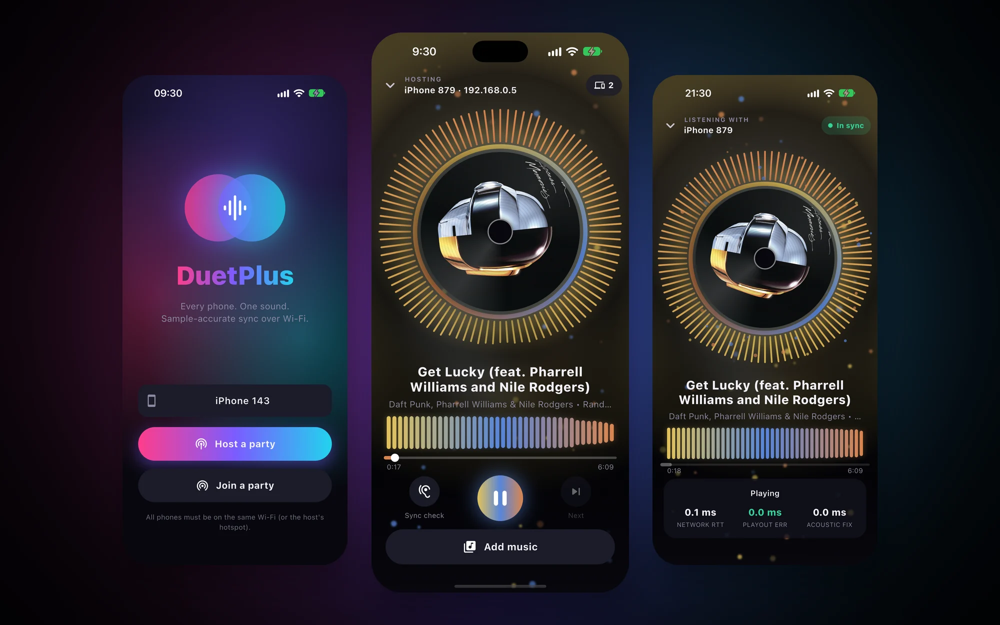
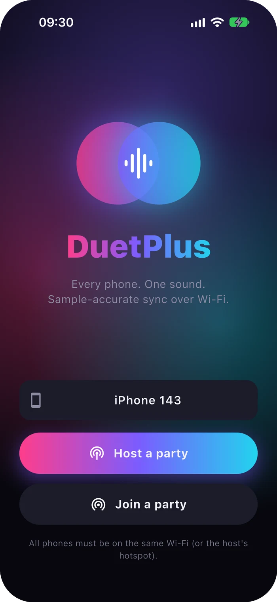
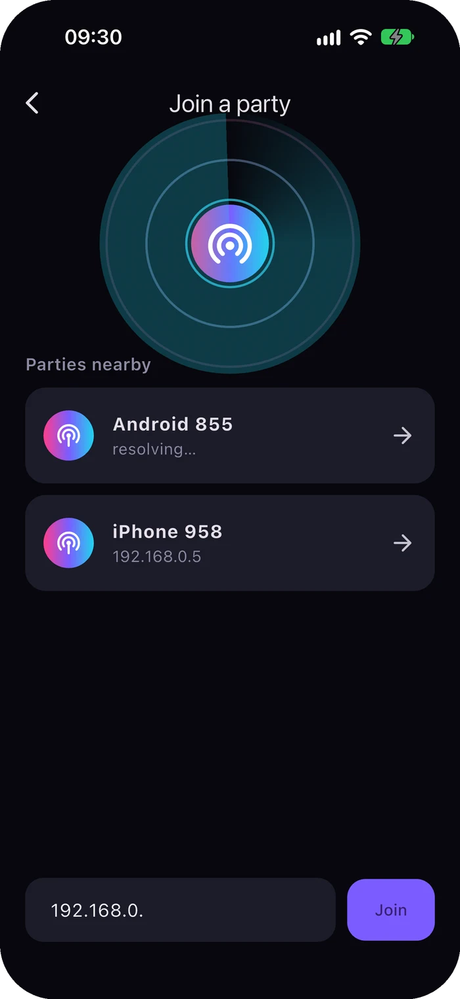
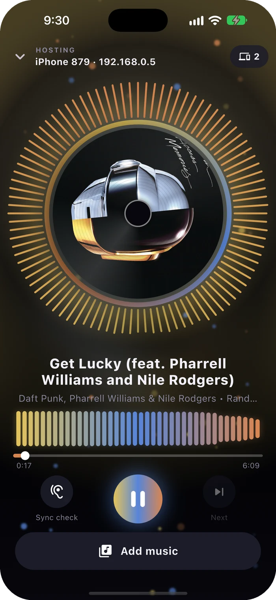
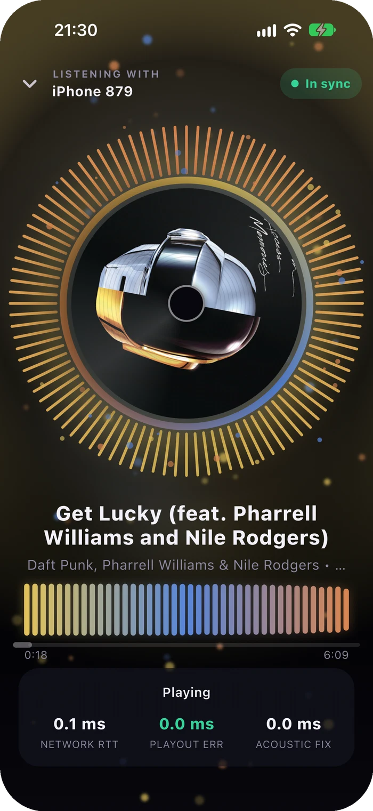

<p align="center">
  
</p>

<h1 align="center">DuetPlus</h1>

<p align="center"><b>Every phone at the party, playing one song, in sync.</b><br>
One phone hosts, everyone else joins over Wi-Fi, and every speaker in the room plays the same sample at the same moment. iPhone and Android, together.</p>

<p align="center">
  <a href="https://www.noxdrop.com/duetplus.html"></a>
</p>

<p align="center">
  <a href="https://github.com/marcocebrian/DuetPlus/releases/latest"></a>
  &nbsp;
  <a href="https://github.com/marcocebrian/DuetPlus/releases/latest"></a>
</p>

<p align="center">Free and open source (GPL-3.0) · Android 9+ · iOS 15+ · <a href="https://www.noxdrop.com/duetplus.html">noxdrop.com/duetplus</a></p>

---

## Start a party in three taps

<table>
  <tr>
    <td align="center" width="33%"><br><b>Host</b><br>One phone taps <i>Host a party</i></td>
    <td align="center" width="33%"><br><b>Join</b><br>The others see it under <i>Parties nearby</i></td>
    <td align="center" width="33%"><br><b>Play</b><br>Pick a song and every phone starts together</td>
  </tr>
</table>

Phones find each other on the same Wi-Fi, or on the host's hotspot. If discovery is blocked on your network, type the last number of the IP shown on the host and you're in. A guest who arrives halfway through a song joins at the right spot, and one whose Wi-Fi drops keeps playing and reconnects on its own.

## Why it stays in sync

Most "play on every phone" apps send a *play* command and hope. Each phone then starts whenever the message arrives and its audio stack gets round to it, so you hear an echo, and it gets worse as the song goes on. DuetPlus doesn't send *play*. It sends **"sample N leaves the speaker at time T"**, and every phone works backwards from there.

- **One clock for everyone.** Guests ping the host ten times a second over UDP, keep only the fastest round trips, and fit the offset and drift between the two clocks. On ordinary Wi-Fi that lands within about a millisecond.
- **The speaker's real delay, from the hardware.** Each audio buffer comes with a timestamp for when it will physically leave the speaker (AAudio on Android, RemoteIO on iOS). A phone with 40 ms of output latency simply renders 40 ms earlier than one with 10 ms.
- **Constant correction.** Small errors are slewed away by resampling up to ±0.1 %, which nobody hears. Anything over 20 ms jumps straight to the right sample with a short crossfade.
- **A microphone check for the rest.** Some phones report their latency wrong. **Sync check** has each phone play a short chirp at a scheduled moment while the host's microphone listens. It measures each phone's real offset, corrects it, and checks again. The correction is saved on each phone.

Every phone decodes the same Opus stream with the same code, so the samples line up exactly, not just the start.

## The music

<table>
  <tr>
    <td width="55%">

**YouTube Music and YouTube.** Search songs (with album, duration and square covers) or videos, or paste any youtube.com, youtu.be or music.youtube.com link. The host fetches only the audio, Opus at about 160 kbps, and hands it to every guest over the local network.

**Your own files.** MP3, FLAC, WAV and WebM go out as they are. M4A, AAC, ALAC and OGG are converted once on the host, because iOS and Android decode AAC with different start padding and would end up about 44 ms apart.

**Covers on the record.** The album art, from YouTube Music or embedded in your files, travels with the song, so every phone shows it, even one without internet.

  </td>
    <td width="45%" align="center"></td>
  </tr>
</table>

How the audio is fetched depends on the phone:

| | First | Fallback |
|---|---|---|
| iPhone | YouTube's own streaming protocol (SABR, via [googlevideo](https://github.com/LuanRT/googlevideo)) in a hidden WebView | An Android guest fetches the song for the host |
| Android | [yt-dlp](https://github.com/yt-dlp/yt-dlp), bundled in the app and updated daily | SABR in a WebView |

> DuetPlus plays YouTube audio outside YouTube's own player, which YouTube's terms of service don't allow. It is here as a technical project for your own listening; respect the rights of the people who made the music.

## Install

**Android:** download `DuetPlus-1.2.0-arm64.apk` from [Releases](https://github.com/marcocebrian/DuetPlus/releases/latest) and open it (allow installing from your browser when asked). The `armv7` file is for phones more than about eight years old.

**iPhone:** the `.ipa` in Releases has to be installed with a sideloading tool such as [AltStore](https://altstore.io) or [Sideloadly](https://sideloadly.io), which signs it with your own Apple ID. Or build it yourself (below).

## Build from source

You need Flutter 3.47+, Xcode, the Android SDK with NDK 29, and CMake.

```bash
git clone https://github.com/marcocebrian/DuetPlus.git
cd DuetPlus

# iOS: build the native core once (static libraries for device and simulator)
core/build_ios.sh

cd app
flutter pub get
flutter run                          # on a connected phone or simulator
flutter build apk --split-per-abi    # Android; Gradle builds the C++ core itself
flutter build ios                    # iOS; set your own team in Xcode first
```

The WebView bundle is checked in as `app/assets/sabr.bundle.js`. To rebuild it:

```bash
cd app/web_sabr && npm install
npx esbuild sabr_entry.ts --bundle --platform=browser --format=iife --target=es2020 --outfile=../assets/sabr.bundle.js
```

## How it's put together

```
core/            C++ shared by both apps: clock sync, playout engine, Opus/MP3/FLAC decoding,
                 host-side transcoding, the chirp analysis behind Sync check
  src/backend_aaudio.cpp, backend_ios.mm   the only per-platform audio code
  tests/         desktop tests for clock, decoding, calibration and the engine
app/             Flutter app: UI, sessions, the TCP protocol, Bonjour/NSD discovery
  lib/core/      sessions, sources (YouTube Music, files), yt-dlp bridge, SABR WebView
  web_sabr/      the TypeScript that runs inside the hidden WebView
  tool/e2e.sh    three processes on one Mac: join, play, pause, seek, Wi-Fi drop, late join
docs/design.md   the original design notes
```

The end-to-end test runs a host and two guests as separate processes on localhost and compares where each one is in the song, sample by sample. Guests stay within 0.01 ms of the host through play, pause, seek, a dropped connection and a late join. On real phones the acoustic Sync check is the number that counts.

## Credits

DuetPlus stands on [libopus](https://opus-codec.org) (BSD), [miniaudio](https://miniaud.io) (MIT-0), [youtubedl-android](https://github.com/yausername/youtubedl-android) (GPL-3.0), [yt-dlp](https://github.com/yt-dlp/yt-dlp) (Unlicense), [googlevideo](https://github.com/LuanRT/googlevideo), [YouTube.js](https://github.com/LuanRT/YouTube.js) and [BgUtils](https://github.com/LuanRT/BgUtils) (MIT), [youtube_explode_dart](https://github.com/Hexer10/youtube_explode_dart) (BSD), and [Flutter](https://flutter.dev).

## License

GPL-3.0. See [LICENSE](LICENSE).

Made by Marco Cebrián Muiño · [NoxDrop](https://www.noxdrop.com)
